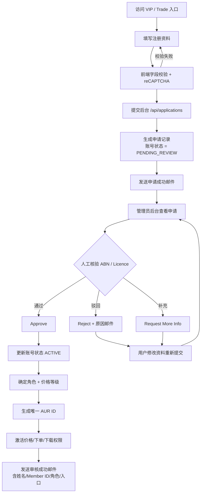
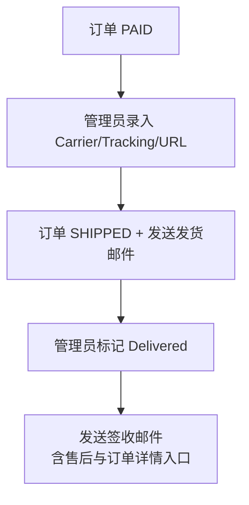
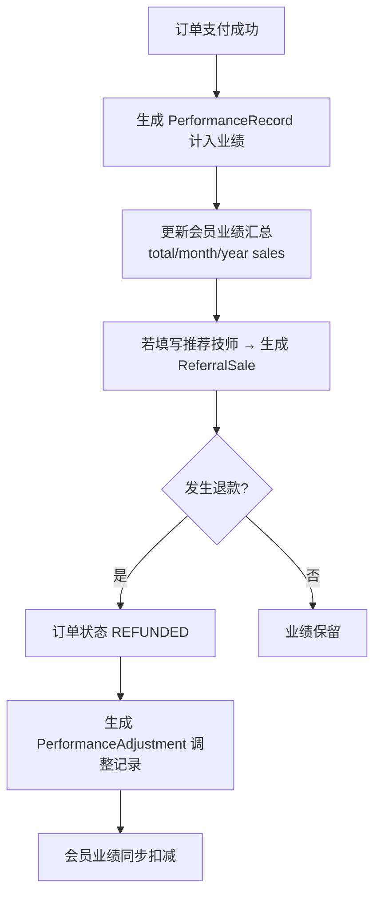
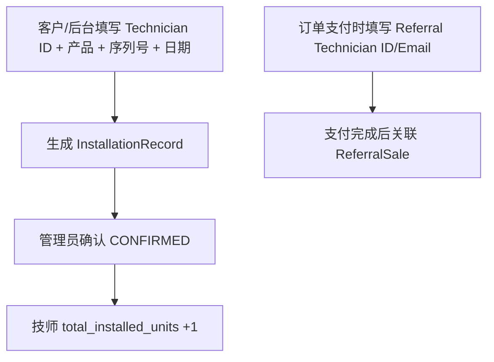

# AURIUS 业务流程图

## 一、注册 → 审核 → 会员 ID 主流程



- AUR ID 规则：一级代理 `AUR-DE-YYYYXXXXXX`、持证技师 `AUR-TR-YYYYXXXXXX`、二级分销商 `AUR-SD-YYYYXXXXXX`。
- 每次审核动作写入 `ApplicationReviewLog`（reviewer、time、previous/new status、notes、ip）。

## 二、登录 → 价格 → 下单 → 支付

```mermaid
flowchart TD
    A[会员登录] --> B[JWT access + refresh Cookie]
    B --> C{accountStatus}
    C -->|PENDING_REVIEW| D[只能查看资料与审核状态<br/>提示 Your application is under review]
    C -->|ACTIVE| E[后端由 JWT 推导角色与价格等级]
    E --> F[浏览商品，仅返回当前等级价格]
    F --> G[加入购物车]
    G --> H[结算下单]
    H --> I[后端重新查询商品/库存/价格<br/>重算 Subtotal/Discount/Shipping/Total]
    I --> J[创建订单 + 状态历史 + 锁库存]
    J --> K[发送订单邮件]
    K --> L{支付方式}
    L -->|PayPal/Stripe| M[网关支付 → 回调确认]
    L -->|Bank Transfer| N[上传凭证 → 管理员审核确认]
    L -->|Sandbox(开发)| O[沙箱模拟支付]
    M --> P[订单变 PAID]
    N --> P
    O --> P
    P --> Q[发送付款确认邮件]
```

- 价格安全：价格接口不接收等级参数，永远由服务端推导；前端篡改 `total` 无效。
- 库存不足 / 未审核用户均无法下单。
- 带选项的商品在详情页提交 `variantId`。服务端验证选项归属和有效状态，并基于当前会员等级基础价与服务端选项调整额重新计价。
- 创建订单时始终锁定商品库存；仅当选项配置了数值库存时才锁定选项库存。选项名称和属性会快照到购物车和订单明细，保留完整订单追溯记录。

## 三、发货 → 签收



## 四、业绩 → 退款



- 业绩口径：仅 `PAID` 订单计入；`PENDING_PAYMENT`/`CANCELLED`/全额退款不计入。
- 退款不覆盖历史，生成可审计的 `PerformanceAdjustment`（原金额/调整金额/调整后金额/原因/时间/操作人）。

## 五、安装报备与推荐



## 六、下载专区

- 未登录 / 未审核用户：无法访问内部资料。
- 审核通过会员：按角色（LEVEL1/2/3）从 `DownloadFile.allowedRoles` 过滤可见资料。
- 每次下载写入 `DownloadAccessLog` 与 `AuditLog`。

## 七、安全与审计

- 登录失败限流 / 全局 API 限流 / 注册限流。
- 关键操作全部写入 `AuditLog`；异常行为（同 IP 多账号、登录爆破、价格查询突增）写入 `SecurityLog`。
- 敏感字段 AES-256-GCM 加密；密码 bcrypt；敏感页面 `noindex` + robots.txt 禁止收录。
